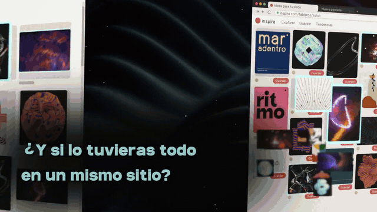

English · [Español](README.es.md)

<p align="center">
  
</p>

<h1 align="center">Grimorio</h1>

<p align="center">
  Your visual library, on your own disk.<br>
  Keep, organize and find references: images, video, audio, PDF and 3D models.<br>
  Free, native, for Linux and Windows. No cloud and no browser inside.
</p>

<p align="center">
  <a href="https://grimorio.frederickandrade.com">Website</a> ·
  <a href="https://github.com/Dohkku/grimorio/releases/latest">Download</a>
</p>

<p align="center">
  <a href="https://grimorio.frederickandrade.com/media/trailer/trailer-v12-en-sonido.mp4">
    
  </a><br>
  <a href="https://grimorio.frederickandrade.com/media/trailer/trailer-v12-en-sonido.mp4">Watch the full trailer (55 s, with sound)</a>
</p>

## What it does

- **Everything in one place.** Images (including PSD, AI, EPS, Krita, Sketch
  and RAW), video that plays when you hover over it, audio with its waveform
  and spectrum, PDF with a viewer, and 3D models (STL, OBJ, PLY, glTF, 3MF,
  and `.blend`/`.fbx` when Blender is installed).
- **Effortless organizing.** Tags with groups and colors, ratings, notes,
  nested folders with colors and **smart folders** that fill themselves from
  a filter.
- **Find things instantly.** A search box that understands `#tag`,
  `stars:>=4`, `type:video`, dates and colors (in English or in Spanish:
  `estrellas:>=4`, `tipo:vídeo`), excludes with a minus sign
  (`#food -#spicy`) and suggests as you type. It answers in milliseconds
  with a hundred thousand items.
- **Really look at things.** A viewer with zoom down to the pixel and a color
  picker, waveforms for audio, pages for PDFs and 3D models with axes like in
  Blender.
- **Keyboard first.** Ratings with the number keys, `Ctrl+K` to tag, `F2` to
  rename (also in batch, with a pattern), `Ctrl+Z` to undo anything.
- **The same image, in several sizes.** The versions of an image are stacked
  and the grid shows just one. You can create lighter versions and remove the
  background without touching the original.
- **Trim on the spot.** An editor for videos and sounds (E, or right click):
  in point, out point, done. The clip is added as a version in its stack
  without re-encoding, so it takes the same time with an hour-long video.
- **Your way.** English or Spanish, night or paper theme, interface size, a safe mode that blurs
  whatever is marked as adult content, duplicates, linked folders on disk,
  screen capture, paste from the clipboard or from a URL.

## Your data is yours

The library is a folder. Each item has its original and a readable
`item.json` next to it:

```json
{
  "name": "estudio de iluminación nocturna",
  "tags": ["nocturno", "referencia"],
  "stars": 4,
  "note": "textura del reflejo en el asfalto",
  "folders": ["01JKF…"]
}
```

`index.sqlite` and the thumbnails are derived files: they can be deleted and
`grim reindex` rebuilds them. The folder syncs with Syncthing or Dropbox and
can be copied like any other. The format is specified in
[docs/FORMATO.md](docs/FORMATO.md).

## The four decisions

1. **Your data is yours, and it is readable.** One JSON per item; the index
   can be rebuilt.
2. **No webview.** No Electron, no Tauri, no WebKitGTK. Native Qt 6.
3. **The core does not know what a window is.** `grimorio-core` builds and is
   tested without a desktop; the interface and `grim` are clients.
4. **Style is data.** Not a single hardcoded color or size in the interface:
   everything comes from a JSON theme that reloads when you save it.

## Install

- **Windows:** the `Grimorio-x.y.z-windows-x64-instalador.exe` installer or the portable `.zip`
  from the [latest release](https://github.com/Dohkku/grimorio/releases/latest).
- **Linux:** the `.tar.gz` from the same page (it uses the system Qt 6), or build it (below).

Optional, to get more out of each file: `ffmpeg` (video and audio),
`pdftoppm` from Poppler (PDF), Blender (`.blend`, `.fbx`), ImageMagick (PSD,
AI, EPS). Without them the files are still imported, with less detail.

## Build

You need stable Rust, CMake and Qt 6.4 or newer (Quick, Qml, Multimedia,
OpenGL, Network; DBus on Linux).

```sh
cargo build --release                         # core and `grim`
cmake -S app -B app/build -DCMAKE_BUILD_TYPE=Release
cmake --build app/build -j
./app/build/grimorio ~/Referencias.grimorio
```

The packages for Ubuntu 24.04 are listed in
[docs/DEPENDENCIAS.md](docs/DEPENDENCIAS.md); Windows is covered in
[docs/WINDOWS.md](docs/WINDOWS.md).

### From the terminal

```sh
export GRIMORIO_LIB=~/Referencias.grimorio
grim init $GRIMORIO_LIB
grim import ~/Descargas/imagenes --tag inspiración
grim search "#cartel estrellas:>=4 orientacion:vertical"
grim stats
```

## Test and measure

```sh
cargo test --release                          # core, CLI and bridge
(cd app/build && ctest)                       # interface: lint, grid, drag
grim synth /tmp/cien-mil.grimorio --items 100000
grim -L /tmp/cien-mil.grimorio bench query    # budget: p95 < 30 ms
```

And real user tests: the app driven with simulated mouse and keyboard on a
virtual display, checking every gesture on disk
([herramientas/recorrido](herramientas/recorrido/recorrido.py)).

## Documentation

- [CHANGELOG.md](CHANGELOG.md): what each version brings (in Spanish: [NOVEDADES.md](NOVEDADES.md))
- [docs/PLAN.md](docs/PLAN.md): scope, architecture and milestones
- [docs/FORMATO.md](docs/FORMATO.md): the library format
- [docs/DEPENDENCIAS.md](docs/DEPENDENCIAS.md): what goes in and under which license
- [app/README.md](app/README.md): the application and all its shortcuts
- [CONTRIBUTING.md](CONTRIBUTING.md): how to contribute

Code identifiers, comments and some of the docs are written in Spanish;
issues and pull requests in English are welcome.

## License

[AGPL-3.0](LICENSE.md), free software. Made by [Frederick Andrade](https://frederickandrade.com).
